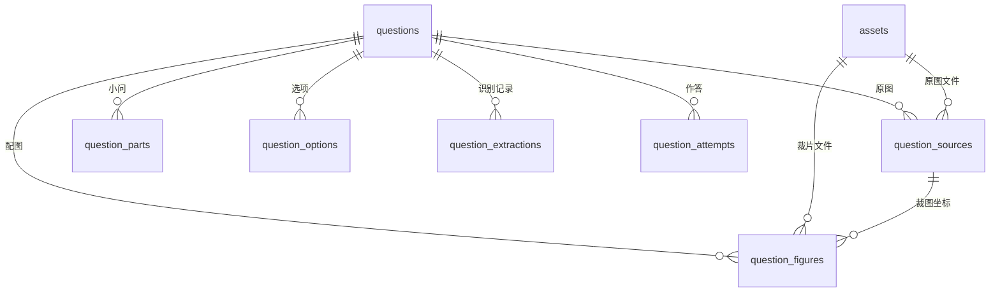

# 截图数学错题：本地数据库与提取方案 v1

> 历史原型说明（2026-10-08更新）：用户现已选择“原照片是权威来源，OCR仅作入库检索索引”。以[当前收录方案](./PRIMARY_MATH_MISTAKE_PLAN_2026-10-08.md)为准。本文件的完整结构化流程、正文来源及识别后确认要求仅描述旧原型，不能当作当前MVP条件；现有SQL未按新要求迁移，也未执行建库。

状态：已完成数据库设计、可执行建库 SQL 与数据约束测试；尚未接入 App 截图菜单、模型提取或错题库界面。本次没有改变正在运行的 0.2.73，也没有创建云端数据库或上传题目。

用户确定先建立本地错题数据库，内容至少包括文字题目、插图及完整题目信息。采用 SQLite 保存结构化信息，独立文件保存原图与配图裁片。建库脚本：[math-mistakes-v1.sql](../db/math-mistakes-v1.sql)；验证：[test_math_mistakes_schema.py](../db/test_math_mistakes_schema.py)。

## 用户流程

新增独立的“截图收录数学题”入口，流程为：

1. 框选包含完整题干、图示与小问的区域，保留原始 PNG。题目跨屏时可追加截图。
2. 在提取窗口选择视觉模型，发送截图进行结构化识别。中文 OCR 可以辅助校验，不作为公式与几何图的唯一识别来源。
3. 左侧显示可缩放原图，右侧显示可编辑的主干、选项、小问、公式和配图。点配图会定位原图中的裁剪框，允许手动调整。
4. 标出模糊上标、被截断文字、不完整选项、疑似漏图等问题。用户修正并确认后才进入正式题库；识别失败时仍能保留原图草稿。
5. 错题库可按日期、年级、题型、知识点筛选，也可打开原图核对。删除先进入可恢复的废纸篓。

“完整提取”指完整保存截图中可见的题目信息。截图以外的条件、被遮住的符号以及没有提供的参考答案，必须标记缺失；不能让模型自行补造。解题、推导和错因分析是后续独立动作，不混入原题字段。

## 存储位置与文件约定

建议 App 的正式数据目录：

```text
~/Library/Application Support/VocabCapture/math-mistakes/
  questions.sqlite
  assets/
    ab/
      <完整 SHA-256>.png
    cd/
      <完整 SHA-256>.jpg
  staging/
  backups/
```

图片按实际文件字节计算 SHA-256，目录前缀取 hash 的前两个字符。扩展名由解码后的 MIME 决定。模型只能返回图片区域和关联信息；路径、hash 和数据库 ID 由应用生成。

原图保存完整像素与原始清晰度，不能复用问答现有的最长边 1600 像素缩放函数作为归档图片。发送模型时根据接口限额产生临时派生图，不改变归档原图；如有缩放，须记录尺度变换并将裁剪框还原到原始像素坐标。

图像属于文件资源，而非数据库大 BLOB：这便于原图查看、独立校验和打包导出。数据库只存不可变的图像元数据及引用；图片文件不写到项目仓库。

## 数据表

| 表 | 内容 | 关键约定 |
|---|---|---|
| `questions` | 主题干、题型、年级、知识点、参考答案、错因备注、校对状态、版本和时间 | `stem_markup` 是主干唯一来源，不重复存储选项和小问；答案来源必须记录 |
| `question_parts` | 带编号的小问和更深一级子问 | 保留层级及排序；每个小问属于同一道题 |
| `question_options` | 根题或小问下的选项标签、正文与顺序 | 支持文字选项、公式选项和仅图片选项 |
| `assets` | 原图、裁片、学生作答照片的 hash、格式、像素尺寸及字节数 | 元数据不可修改；同字节图片共享文件 |
| `question_sources` | 一道题对应的原截图、顺序和题目区域 | 支持一道题多张图、一张图多道题 |
| `question_figures` | 配图裁片、原图位置、图注，以及所属主干、小问或选项 | 配图从原图裁出，不能生成替代图；外键防止跨题误关联 |
| `question_extractions` | 模型、服务主机、提示版本、结构化原始响应及待校对问题 | 识别结果留作追溯；用户编辑后的正式字段是题目来源 |
| `question_attempts` | 学生答案、作答照片、对错及反馈 | 不覆盖原题；AI 反馈与原题参考答案分别保存 |

另外有 `schema_migrations` 记录建库/迁移版本。v1 预留作答表，但第一版收录流程不需要先实现完整复习系统。



数据库 ID 使用应用生成的 UUID；图片 ID 使用内容 hash。当前目录属于本机个人库，不依赖阅读达人登录；未来增加云端同步时可保留 UUID 和内容 hash，但需另行设计账号归属与合并冲突。

## 正文与公式

主干、小问和选项的 `*_markup` 字段采用限定的 Markdown + LaTeX 表达：

- 保留中文、数字、标点、单位、题号和条件；正文不自动改写成模型解释。
- 行内公式使用 `$...$`，独立公式使用 `$$...$$`。原样存储反斜杠，不把上标、分数或根式摊平成普通字符。
- 图像位置写为 `{{figure:<应用生成的 figure UUID>}}`，展示层通过数据库引用取图，不使用模型提供的网络 URL。
- 表格保留单元格与行列关系。复杂合并单元格表格同时保留裁图与结构化识别记录，不强行压平成错位文本。
- 手写答案、教师批注与印刷题干分别呈现，无法可靠区分时标出待校对，不能无提示地剔除。

例如主干可存为：

```text
如图，$AB=3\,\mathrm{cm}$，$AC=4\,\mathrm{cm}$，$\angle A=90^\circ$。
{{figure:<figure UUID>}}
```

小问分别保存“(1) 求 $BC$”和“(2) 求三角形的面积”，选项再挂到相应小问。重建题目时依次加载主干、小问、选项及引用图片，不靠全文拼接猜测所属关系。

公式渲染器属于后续界面实现，需要单独验证；当前方案没有引入新渲染依赖。原图对照始终保留，公式渲染成功也不能证明识别正确。展示层应把题目内容当数据处理，不直接执行模型输出的 HTML。

## 配图坐标与完整性

模型输出裁剪区域时统一使用左上角为原点的归一化边界 `[left, top, right, bottom]`。应用验证 `0 <= left < right <= 1`、`0 <= top < bottom <= 1` 后，按实际送图到原图的变换还原坐标：左/上向下取整，右/下向上取整。

数据库存的是原图中的整数像素坐标 `x/y/width/height`，右边界和下边界不包含在矩形内。原图预览、鼠标框选、Core Graphics 裁剪之间的坐标变换必须用带角点标记的测试图验证，防止上下翻转。

- 裁片必须包含图内标注、坐标轴、刻度、图例和必要单位；边界不确定时允许用户调整。
- 原图区域越界、配图超出所属题目区域、裁片尺寸与区域不一致，由数据库约束拒绝，不静默截掉。
- 多道题共享一张配图时，每题建立自己的配图引用；实际文件可通过 hash 去重。
- 图片是原图裁片，不能让模型重画几何图。模型对“平行、垂直、等长”等关系的推断只能出现在解析中，不能新增到原题条件。
- `question_sources` 指向保留的完整原截图，即使配图裁错也能重新裁剪。

外键和触发器可保护关联与像素边界，无法判断符号是否看错、裁图是否遗漏图注。题干完整性、公式正确性、图片内容及实际文件存在性仍由应用验证和人工对照负责。

## 模型提取契约

复用现有常驻 LangChain 进程和多模型配置，但新增数学题提取任务与提示，不能沿用当前阅读助教“纯文本、150–300 字”的问答提示。

截至 2026-10-06，官方 [DeepSeek Flash 视觉文档](https://api-docs.deepseek.com/guides/vision/) 与 [Kimi 视觉文档](https://platform.kimi.com/docs/guide/use-kimi-vision-model) 均说明其相应模型支持图片输入。因此可先用现有 DeepSeek Flash 和 Kimi K2.6 做同题样本对照，再决定默认提取模型。文档中的支持不等于本机数学题提取已验证；第三方网关还要实际测试。

第一版采用单次视觉提取，返回包含以下字段的版本化 JSON：

```json
{
  "schema_version": 1,
  "questions": [
    {
      "source_question_number": "12",
      "question_type": "short_answer",
      "stem_markup": "如图，$AB=3\\,\\mathrm{cm}$，$AC=4\\,\\mathrm{cm}$，$\\angle A=90^\\circ$。{{figure:figure-1}}",
      "parts": [
        {"label": "(1)", "body_markup": "求 $BC$。", "options": [], "parts": []}
      ],
      "options": [],
      "figures": [
        {"local_ref": "figure-1", "source_index": 0, "bbox": [0.1, 0.2, 0.4, 0.6], "belongs_to": "stem", "caption_markup": null}
      ],
      "reference_answer_markup": null,
      "issues": []
    }
  ]
}
```

此 JSON 是模型到应用的契约草案，不直接执行入库。`local_ref` 仅用于该响应内关联，应用生成 UUID 并替换图片占位引用。主干含图的位置包含对应 `{{figure:figure-1}}` 占位；若响应缺少位置关联，校对窗口展示为未定位图片，不能自动判定完整。

应用验证所有字段类型、必填字段、选项标签、排序、引用、区域及响应是否截断。父子小问不得形成循环；知识点标签采用 `{label, origin}`，来源为用户、原图或 AI 推断，不把推断当原题事实。JSON 合法只说明可解析，不能直接把 `review_state` 改为 confirmed。

需要校对的问题记录例如：

```json
{"field":"parts[0].body_markup","reason":"分母模糊，可能是 3 或 8","source_index":0,"requires_review":true}
```

用户确认后问题可在识别历史中保留，界面记录其修正。若模型未能识别但原图可读，允许手动录入后确认；无内容或原截图损坏时只能留草稿。

## 保存、删除与备份

数据库事务和文件写入不能合成一个跨资源事务。采取“先准备文件，再提交引用”的顺序：

1. 生成原图/裁片到 staging，解码确认尺寸、校验 hash，写入并同步文件。
2. 将文件原子移动到 hash 路径。相同 hash 已存在时校验文件一致，避免覆盖冲突。
3. 使用 `BEGIN IMMEDIATE` 将资产元数据、题目、原图引用、小问、选项、配图和提取记录一起写入，成功后 commit。
4. 数据库提交失败时回滚所有题目记录。已准备但无人引用的文件可保留为待清理文件，稍后在单一写入协调器锁内、重新查证全部引用后清理；不能按这次失败直接删除共享图片。
5. 编辑正式题目时使用 `WHERE id=? AND revision=?`，更新成功才递增 revision；冲突时保留用户草稿。

每个 SQLite 连接都必须启用 `foreign_keys=ON`；这是连接级设置，建库时开启不能替代后续连接配置。[SQLite 官方外键说明](https://www.sqlite.org/foreignkeys.html)

数据库开启 WAL、FULL 同步和有界 busy timeout，业务层采用单一写入协调器。参考 [SQLite 事务说明](https://www.sqlite.org/lang_transaction.html)。迁移按 `schema_migrations` / `user_version` 执行，v1 脚本仅用于新库；不能对已有数据库反复执行或重置版本。

删除先设 `deleted_at`，题目和图片仍可恢复。之后若永久清理，删除题目关联行，不直接删除资产；只有查询原图、配图和学生作答照片三类引用均为空的文件才允许清理。题目的硬删除可级联清理其记录，共享图片继续保留。

备份使用 SQLite backup API 创建一致数据库快照，并包含快照引用的图片文件。不要只复制活动数据库的 `.sqlite` 文件而漏掉 WAL；也不要在导出过程中让图片垃圾清理删除被快照引用的文件。导出包应含数据库、图片与 manifest，恢复时验证 hash 和全部引用。

## 实施范围与验收

第一阶段：新增截图入口、保留原图、视觉提取、配图裁剪与校对、SQLite 保存、题库列表和题目详情。继续使用现有问答模型配置，但保留数学提取的独立模型选择。

后续阶段：批量多题/跨页优化、错因分类与重练、公式渲染优化、导出、云端同步。数据库已考虑多原图和小问，第一阶段可先提供追加截图与逐题确认，避免静默漏题。

应用实现后的验收样本至少包括：中文应用题、分式/根式/上标、几何图及图注、坐标图、表格、图片选项、多小问、多题同屏、跨截图题目、模糊/截断图、手写答案和教师批注。校对后每道题必须能用原图、正文、小问、选项和配图重新完整展示，重启后仍可打开，取消提取不产生正式题目。

本次验证：

```bash
python3 -m unittest discover -s mac-vocab-capture/db -p 'test_math_mistakes_schema.py' -v
```

9 项测试通过，覆盖 LaTeX/中文往返、图片外键、跨题关联、裁片边界与尺寸、选项作用域、确认前原图保留、事务回滚、恢复/共享资源、作答与参考答案隔离、识别问题及 schema 版本。测试只使用隔离数据库中的合成元数据；没有真实截图提取准确率或 GUI 功能验证，也没有改变本机生词和模型配置。
